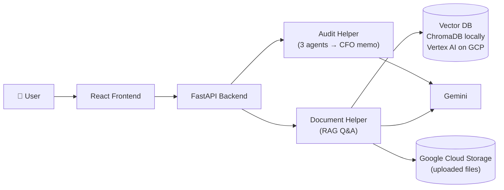
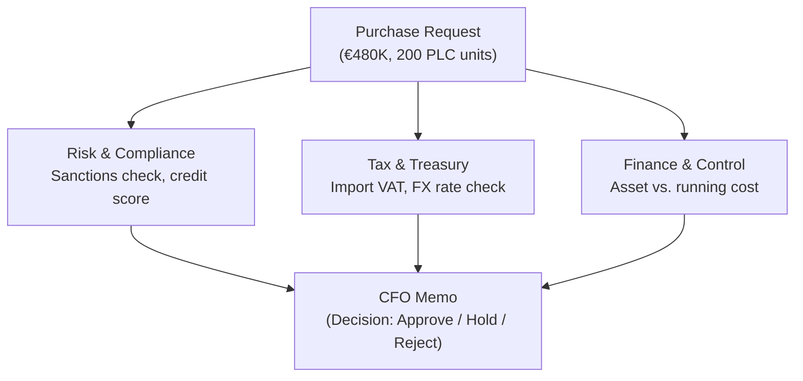
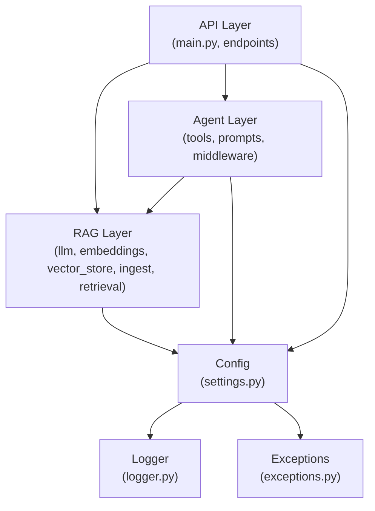
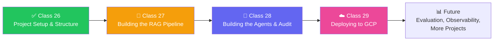

# 🏗️ Class 26: Building the Meridian AI Project from Scratch — Setup, Structure & Foundations

**Author:** Pragati  
**Course:** Agentic AI Specialization  
**Date:** 10 October 2026

---

## 📋 Table of Contents
1. [Quick Updates](#-quick-updates)
2. [Project Overview — Meridian AI](#-project-overview--meridian-ai)
3. [The Business Problem (Layman's Terms)](#-the-business-problem-laymans-terms)
4. [The Solution Architecture](#-the-solution-architecture)
5. [Why This Project Matters](#-why-this-project-matters)
6. [The Fictional Company — Aldermoor Industries](#-the-fictional-company--aldermoor-industries)
7. [The Four Checks Before Payment](#-the-four-checks-before-payment)
8. [The Four Departments & Their Questions](#-the-four-departments--their-questions)
9. [The Four Users of Meridian AI](#-the-four-users-of-meridian-ai)
10. [Why This Problem Is Harder Than It Looks](#-why-this-problem-is-harder-than-it-looks)
11. [Scope Definition — What Meridian AI Does and Doesn't Do](#-scope-definition--what-meridian-ai-does-and-doesnt-do)
12. [The Two-Lens Approach: AI Engineer & FDE](#-the-two-lens-approach-ai-engineer--fde)
13. [Tools & Prerequisites](#-tools--prerequisites)
14. [Setting Up the Project from Scratch](#-setting-up-the-project-from-scratch)
15. [Understanding the Project Structure](#-understanding-the-project-structure)
16. [Dependencies & Requirements](#-dependencies--requirements)
17. [Environment Variables & Secrets](#-environment-variables--secrets)
18. [Git & GitHub Setup](#-git--github-setup)
19. [Building the Backend Skeleton](#-building-the-backend-skeleton)
20. [The Build Order & Architecture](#-the-build-order--architecture)
21. [Live Q&A Highlights](#-live-qa-highlights)
22. [Key Pointers to Remember](#-key-pointers-to-remember)
23. [Action Items](#-action-items)
24. [What's Next](#-whats-next)

---

## 📰 Quick Updates

- 🎯 **Today's scope:** This class was the complete project setup session for **Meridian AI** — a realistic, production-shaped AI application that will be built over the next few sessions. We covered the business problem, the solution architecture, the fictional company background, and then started setting up the project from scratch using VS Code, UV, and Python.
- 🏗️ **Project structure:** The session walked through creating the complete project skeleton, installing dependencies with UV, understanding the folder structure, setting up Git, and creating the first commit.
- 🗺️ **Roadmap:** The plan is to complete this project over 3 sessions (10th, 11th, 17th), then another project after that, and finally a project assigned to students. October is projects-focused — at least two on GCP, with AWS and Azure projects coming later.
- 📝 **Important:** The complete code was already shared before this class. This session focused on understanding *why* each file exists, *why* each technology is used, and building it step-by-step from an empty folder — not just copying code.
- ⚠️ **Critical note:** This is a "semi-scratch" approach. If you haven't gone through the shared repo, you will face difficulty. The code is not being typed line-by-line; rather, the *reasoning* behind each piece is being explained.

---

## 🏗️ Project Overview — Meridian AI

**Analogy:** Think of Meridian AI like a **virtual audit team for a company**. You upload documents (contracts, invoices, policies), and the AI answers your questions in plain English. Separately, you submit a purchase request, and three specialist AI agents (risk, tax, finance control) review it and produce a decision memo — just like a real company's approval workflow.

Meridian AI is the solution being built for a fictional company called **Aldermoor Industries**. It has two main features:

| Feature | What It Does |
|---|---|
| **Document Helper (RAG Q&A)** | Upload company documents (PDFs), and anyone can ask questions in plain English. The system answers **only from the uploaded documents** — grounded, with sources visible. |
| **Audit Helper (Procurement Audit)** | Paste a purchase request, and three specialist AI agents (Risk & Compliance, Tax & Treasury, Finance & Control) check it from different angles. A final step writes one memo with a decision for the CFO. |



**The tech stack:**
- **Frontend:** React (with ShadCN, Tailwind)
- **Backend:** Python, FastAPI
- **AI framework:** LangChain
- **LLM:** Gemini (chosen because it's best with Google Cloud)
- **Embeddings & Vector Search:** Local ChromaDB first, then Vertex AI Vector Search on GCP
- **Storage:** Google Cloud Storage (GCS) for uploaded files
- **Deployment:** Docker, Cloud Run, Secret Manager, GitHub Actions

---

## 📝 The Business Problem (Layman's Terms)

**Analogy:** Think of a company like **a hospital with many departments**. Every purchase request has to go through multiple departments — Risk, Tax, Finance, and finally the CFO. Each department has its own rules, its own documents, and its own questions. Right now, this happens **manually over days**, with requests sitting in someone's inbox.

The company — Aldermoor Industries — has **two major problems**:

### Problem 1: Document Q&A
- They have **lots of internal documents** (procurement policies, payment terms, EU tariff schedules, annual reports, etc.)
- They need a system that can answer questions **grounded in these documents**
- They **cannot upload them to ChatGPT or Claude** — that's a massive data security risk
- The documents can be very large (thousands of pages, GBs of data)
- They need to maintain and save these documents securely

### Problem 2: Procurement Audit
- Every purchase request goes through **four checks** (Risk, Tax, Finance, CFO)
- Currently this takes **days** — each department checks in turn, and requests wait in inboxes
- The rules are **hidden in long PDFs** — payment terms, approval limits, tax rules
- **Different people give different answers** to the same question
- **No record** — when an auditor asks why something was approved, nobody remembers

> *"The answer is somewhere in the PDF. What are our payment terms for servo motor suppliers? Four documents, four kinds of answers. Procurement policy, payment terms, EU tariff schedule, annual report. Based on all these, we take this call."*

---

## 🏛️ The Solution Architecture

**Analogy:** Think of Meridian AI like a **smart hospital triage system**. Instead of you running between departments, the system routes your request to the right specialists, each with their own tools and expertise, and then combines their reports into one clear decision.

The solution has **two helpers** inside **one application**:

### Document Helper
```
Upload PDFs → Index → Embed → Store → Query → Grounded Answer
```
- Upload company policy PDFs
- System chunks them, creates embeddings, stores in vector DB
- Anyone asks a question in plain English
- Answer comes **only from the uploaded documents** — with source shown

### Audit Helper
```
Purchase Request → Risk Agent → Tax Agent → Control Agent → CFO Memo
```
- Buyer pastes a purchase request
- **Risk & Compliance** checks sanction list and credit score
- **Tax & Treasury** calculates import VAT, checks exchange rate against live data
- **Finance & Control** classifies asset vs. running cost, checks approval thresholds
- **CFO step** reads all three reports, writes one decision memo

**The decision follows written rules, not moods:**
- **Rejected** — any report contains a red alert (e.g., sanctioned supplier)
- **Conditional Hold** — FX error >5% from market rate, or high credit risk, or amount above €250K
- **Approved** — all three reports clear, memo confirms cost center and ledger account



---

## 🎯 Why This Project Matters

**Analogy:** Think of this project like **learning to build a house from the foundation up**. You could watch someone build a house and copy what they do, but if you don't understand *why* the foundation is dug a certain way, *why* the plumbing runs where it does, you'll never be able to build your own house. This project teaches you the *why*.

Three reasons this project is important:

| Reason | What It Means |
|---|---|
| **Interview-ready** | You can explain the business problem, the architecture, and the decisions — not just list technologies. |
| **Production-shaped** | This is not a toy project. It has health endpoints, logging, error handling, Docker, deployment pipelines. |
| **Two lenses** | You learn it from both an **AI Engineer** lens (does it work? can we test it?) and an **FDE (Forward-Deployed Engineer)** lens (will people use it? does it solve their problem?). |

> *"If you say in an interview that, 'I developed the project using FastAPI, Docker, React,' the person will say bye-bye. But if you say, 'We took an approach where the company based in Germany had these problems…' — that's when you get the job."*

---

## 🏢 The Fictional Company — Aldermoor Industries

**Analogy:** Think of Aldermoor Industries like a **real German manufacturing giant**. It's fictional, but every detail is modeled on real companies — the way they buy, the way they approve, the way they audit.

| Detail | Value |
|---|---|
| **Name** | Aldermoor Industries |
| **What they do** | Build machines that pack bottles and boxes |
| **Headquarters** | Hamburg, Germany |
| **Global presence** | 40+ subsidiaries worldwide |
| **What they buy** | Servo motors, controllers, sensors, steel, food-grade chemicals, packaging material |
| **Why fictional?** | Every person, figure, and document is made up for learning. But it's very, very close to a real-world company. |

**The pattern:** A company with many suppliers, strict internal rules, and documents that hold the answers.

**Example purchase order (in the demo):**
- Vendor: Foreign supplier (e.g., Japan)
- Item: Industrial PLC controller + HMI panels
- Quantity: 200 units
- Total cost: €480,000
- Origin: Japan → Destination: Germany
- FX rate: Quoted rate (e.g., 1 EUR = 163 JPY)

> *"Nothing is paid until it is checked. Request, risk, tax, control, accounting, and approval. CFO takes the final decision. Then the complete payment happens."*

---

## ✅ The Four Checks Before Payment

**Analogy:** Think of this like **airport security checkpoints**. You can't board the plane until you've passed through every checkpoint in order. Each checkpoint has its own rules, its own questions, and its own authority to stop you.

| Check | Department | Key Question | Rule Example |
|---|--------|-------------|-------------|
| **1. Risk** | Risk & Compliance | Is the supplier sanctioned? What's their credit score? | Credit score ≥75 = low risk; 50–74 = deposit/LC; <50 = escalate to CFO |
| **2. Tax** | Tax & Treasury | What's the import VAT? Is the FX rate fair? | Germany import VAT = 19%; FX rate must be within 5% of market rate |
| **3. Control** | Finance & Control | Is this an asset (CapEx) or running cost (OpEx)? Who needs to sign? | Above €250K = department head signs; above €1M = CFO + management board |
| **4. Approval** | CFO | Final decision based on all reports | Approve / Conditional Hold / Reject |

**Why this order matters:** Payment and CFO decision come **last**, never first. Each department does its check in sequence, and only when all checks pass does the payment happen.

> *"The reason I'm covering these things is so you understand how a typical company structure looks like. I don't want you to think of a project from just a technical or developer lens. Now we have to take it as a holistic lens."*

---

## 🏢 The Four Departments & Their Questions

Each department has its own rules, its own documents, and its own way of checking:

### 1. Risk & Compliance
- **Screens the supplier** against sanction lists (US OFAC, EU, UK, etc.)
- **Checks credit score:** 75+ = low risk; 50–74 = deposit or letter of credit; below 50 = escalate to CFO
- **Why it matters:** Paying a sanctioned supplier is a legal violation

### 2. Tax & Treasury
- **Import VAT:** Germany charges 19% on the customs value plus duty
- **Custom duty:** Based on tariff code (e.g., 2.2% for Japanese PLC controllers)
- **FX rate check:** Quoted exchange rate must be within 5% of the market rate
- **Why it matters:** An off-market FX rate can mean hidden costs or fraud

### 3. Finance & Control
- **Asset vs. running cost classification:** CapEx vs. OpEx
- **Approval thresholds:** Above €250K = department head signs; above €1M = CFO + management board
- **Why it matters:** Treating an asset as a running cost (or vice versa) distorts the books

### 4. CFO
- **Reads all three reports**
- **Writes one decision memo**
- **Final authority:** Approve / Conditional Hold / Reject
- **Why it matters:** Someone has to be accountable for the decision

> *"Normally, all of this takes days. If you're going through the same, it will actually take days for us to go and get them approved. So can we assist the same? That is the idea."*

---

## 👥 The Four Users of Meridian AI

**Analogy:** Think of Meridian AI like a **multi-tool Swiss Army knife**. Different people use different tools for different jobs, but it's all one device.

| User | What They Do | What They Need from Meridian AI |
|---|---|---|
| **Buyer** | Pastes a purchase request, reads the audit memo | Understand where the request is failing (risk, tax, or control) |
| **Policy Owner** | Uploads policy documents | Understand where the answers come from — source-grounded |
| **Anyone** | Asks what the policy says about a topic in plain English | Simple, grounded answers without reading long PDFs |
| **Developer/IT** | Watches system changes and logs | System status, logs, error handling |

> *"Depending on where exactly you sit, your expectation changes. As a buyer, you're mainly interested in the procurement audit. As a policy owner, you're mainly interested in uploading policies and getting answers. As a developer, you want logs and system status."*

---

## ⚠️ Why This Problem Is Harder Than It Looks

**Analogy:** Think of this like **a Rubik's cube**. It looks simple — just colored squares. But once you start turning, you realize there are billions of combinations, and each move affects all the others. This project is the same — it looks simple until you start building.

### The Four Pains

| Pain | What It Means |
|---|---|
| **Slow** | Each department checks in turn, and requests wait in someone's inbox. Days, not minutes. |
| **Rules are hidden** | Payment terms, approval limits, tax rules live in long PDFs. |
| **People differ** | Two buyers can get two different answers to the same question. |
| **No record** | An auditor asks why it was approved, and nobody remembers. |

### What a Miss Can Cause

- Paying a **sanctioned supplier** (legal violation)
- Treating an **asset as a running cost** (accounting error)
- Accepting an **off-market exchange rate** (hidden costs)
- **No trail** — can't explain a decision when an auditor asks

### Why Obvious Fixes Fall Short

| Fix | What It Fixes | What It Leaves Open |
|---|---|---|
| **Reminder emails** | A little speed | Rules still hidden, answers still differ |
| **Shared folder of PDFs** | Rules become findable | Someone must read and apply them |
| **General chatbot** | Fast, fluent answers | Never seen Aldermoor documents, can't check sanction lists |
| **Fixed tooling code** | Consistency | Can't read PDFs or judge whether a supplier looks risky |

> *"An AI model alone is a brilliant new hire on day one. Smart, but it has never seen your files, and it cannot pick up the phone. The reason I put it this way is because we think that just adding AI will solve it. That is not what's going to happen. We are going to come up with a complete system of agents and everything so that it actually helps."*

---

## 📐 Scope Definition — What Meridian AI Does and Doesn't Do

**Analogy:** Think of scope definition like **drawing a fence around your garden**. Everything inside the fence is what you'll build. Everything outside is explicitly out of scope — not because it's not valuable, but because you can't build everything at once.

### What It Does

| Feature | Detail |
|---|---|
| **Document Q&A** | Upload PDFs, ask questions in plain English, get grounded answers with sources |
| **Procurement Audit** | Paste a purchase request, get a CFO memo with a decision |
| **Live FX check** | The only external data source — exchange rate is checked against live market data |
| **Written record** | Every audit leaves a trail — decision, reasons, sources |

### What It Does NOT Do

| Limitation | Why |
|---|---|
| **No real sanctions/credit/tax data** | 4 of the 5 checks use AI model general knowledge — a real company would connect real sources |
| **No sign-in** | Anyone can enter — the demo uses only fictional documents |
| **No persistent upload history** | Upload history is kept in memory, reset when the server restarts |
| **Only text PDFs** | Scanned images have no text to read until OCR is applied |
| **No MCP** | This project doesn't use MCP — that's for a future project |
| **No evaluation** | Evaluation and observability come in later projects |

> *"It is equally important to understand what we are not doing in a project, so the scope stays limited. If you have to change any policies, you will have to get that change from the source — you can't just upload a document and influence the procurement audit."*

---

## 🔍 The Two-Lens Approach: AI Engineer & FDE

**Analogy:** Think of an **AI Engineer** like a **master chef** who creates a dish. Think of an **FDE (Forward-Deployed Engineer)** like a **restaurant manager** who makes sure the dish is actually served, the customers like it, and the kitchen runs smoothly. Both are essential, but they see the world differently.

| Aspect | AI Engineer | FDE (Forward-Deployed Engineer) |
|---|---|---|
| **Starts from** | A defined problem and data | People, process, and constraints at the customer end |
| **Main question** | Does it work? Can we prove it? | Will people use it and trust it? |
| **Spends time on** | Prompts, tools, retrieval, tests | Observation, data access, rollout, adoption |
| **Delivers** | A tested, working system | A system in daily use + handover + adoption |
| **Success looks like** | Correct, fast, affordable | Measured gain against baseline |
| **Works where** | Can work remotely | Works inside the customer organization |

> *"The AI engineer design, build, test, ships the AI part of a system and proves that it works. The FDE works inside the customer organization to turn a working system into daily use. It starts from the people, the process, and the constraint at the customer end."*

**Why this matters:** In today's world, it makes sense for every role to understand both lenses. The project teaches you both.

---

## 🛠️ Tools & Prerequisites

**Analogy:** Think of this like **gathering ingredients before cooking**. You need the right tools before you can build anything.

### What You Need

| Tool | Version | Why |
|---|---|---|
| **Git** | Latest | Version control — tracks every change to your code |
| **UV** | Latest | Python package manager and project manager (replaces pip + venv) |
| **Python** | 3.12 (or 3.10+) | The programming language |
| **VS Code** | Latest | Code editor |
| **Node.js** | 20+ | For the React frontend |
| **Gemini API key** | — | For the AI model |

### What Each Tool Does

| Tool | What It Is | Why We Use It |
|---|---|---|
| **Git** | Version control system (created by Linus Torvalds) | Tracks every change — you can go back to any version |
| **GitHub** | A website that stores Git repositories | Share code, collaborate, deploy |
| **UV** | Python package manager + project manager | One tool for Python version, environment, packages — faster and simpler than pip + venv |
| **Python 3.12** | Programming language | The language the backend is written in |
| **VS Code** | Code editor | Where you write and run code |
| **Node.js** | JavaScript runtime | Required for the React frontend |
| **Gemini API** | Google's LLM API | The AI model that powers Meridian AI |

> *"UV replaces venv and pip. One tool — Python version, environment, packages — everything it manages. You don't have to actually worry about anything. Same result, fewer steps, and it's faster as well."*

---

## 🚀 Setting Up the Project from Scratch

**Analogy:** Think of this like **building a house from the foundation**. You don't start by painting the walls; you start by digging the foundation, laying the pipes, and building the frame. This section is the foundation.

### Step 1: Check Git Installation

```bash
git --version
```

If you get a version number, Git is installed. If not, install it from [git-scm.com](https://git-scm.com).

> *"Git and GitHub are different. Git is the core technology — the version control system. GitHub and GitLab are platforms that help you collaborate. Even if you're not pushing to GitHub, Git helps you maintain version history."*

### Step 2: Install UV

**macOS / Linux:**
```bash
curl -LsSf https://astral.sh/uv/install.sh | sh
```

**Windows (PowerShell):**
```powershell
powershell -ExecutionPolicy ByPass -c "irm https://astral.sh/uv/install.ps1 | iex"
```

**Verify:**
```bash
uv --version
```

### Step 3: Install Python 3.12

```bash
uv python install 3.12
```

> *"Normally, I prefer that you use one or two versions behind only. It is not any flex to have the latest version. If you have worked in development, you will understand — it's better to use a stable version."*

### Step 4: Create the Project

```bash
mkdir meridian-ai
cd meridian-ai
uv init
```

`uv init` creates:
- `pyproject.toml` — project metadata and dependencies
- `.python-version` — pins the Python version
- `README.md` — project documentation
- `src/` — source code folder

### Step 5: Open in VS Code

```bash
code .
```

> *"The very first thing which we will check is the Git version. Then UV. Then Python. Then we create the project. So these are all the things which you will need."*

---

## 📁 Understanding the Project Structure

**Analogy:** Think of the project structure like a **well-organized office building**. Each department has its own floor, each team has its own room, and each person has their own desk. You know exactly where to find what you need.

### What Each File/Folder Means

| File/Folder | What It Is | Why It Matters |
|---|---|---|
| `meridian-ai/` | The project root folder | Where everything lives |
| `backend/` | The FastAPI backend | Where the AI logic and API live |
| `frontend/` | The React frontend | What users see in the browser |
| `sample-docs/` | Sample PDF documents | Test documents for the RAG system |
| `.env` | Environment variables (secrets) | API keys, database URLs — **never pushed to Git** |
| `.env.example` | Template for `.env` | Shows what variables are needed — **pushed to Git** |
| `requirements.txt` | Production dependencies | What the app needs to run |
| `requirements-dev.txt` | Development dependencies | Extra tools for testing (pytest, httpx) |
| `pyproject.toml` | Project metadata and dependencies | UV's central config file |
| `uv.lock` | Exact locked versions | Ensures everyone gets the same versions |
| `.venv/` | Virtual environment | Where packages are installed — **never pushed to Git** |
| `.gitignore` | Files Git should ignore | `.env`, `.venv`, `__pycache__`, etc. |
| `README.md` | Project documentation | How to run, what it does |
| `Dockerfile` | Docker container definition | For deployment |
| `docker-compose.yml` | Multi-container setup | For local development with frontend + backend |
| `.github/workflows/` | GitHub Actions CI/CD | Automated testing and deployment |

### The Backend Structure (Detailed)

```
backend/
├── api/              # API endpoints
│   ├── main.py       # Creates the FastAPI app, plugs everything in
│   ├── endpoints/    # Individual route handlers
│   └── schemas/      # Pydantic models for request/response
├── agent/            # AI agent logic
│   ├── tools.py      # Tools the agents can use
│   ├── prompts.py    # System prompts for each agent
│   ├── middleware.py # Handoff/state management
│   └── agents.py     # Agent definitions
├── rag/              # RAG pipeline
│   ├── llm.py        # LLM configuration
│   ├── embeddings.py # Embedding model
│   ├── vector_store.py # Vector DB connection
│   ├── document_store.py # Document storage
│   ├── ingest.py     # Document ingestion
│   └── retrieval.py  # Retrieval logic
├── config/           # Configuration
│   └── settings.py   # Pydantic settings (reads .env)
├── logger/           # Logging
│   └── logger.py     # Centralized logging
├── exceptions/       # Custom exceptions
│   └── exceptions.py # Error handling
└── tests/            # Tests
    └── test_*.py     # Pytest test files
```

> *"One file, one job. Every piece of code has a home before we write a single line. Where does the tax prompt go? It should go in `agent/prompts.py`. Where does the Gemini call go? `rag/llm.py`. Where does the web address go? `api/endpoints/`. Where do settings come from? `config/settings.py`. Where does the logger go? `logger/logger.py`."*

---

## 📦 Dependencies & Requirements

**Analogy:** Think of `requirements.txt` like a **shopping list for your project**. It tells you exactly what packages (and which versions) you need to install.

### `requirements.txt` — Production Dependencies

```
fastapi==0.115.0
uvicorn==0.32.0
langchain==0.3.7
langchain-core==0.3.15
langchain-google-genai==2.0.0
langchain-community==0.3.5
langchain-chroma==0.1.4
langchain-text-splitters==0.3.2
chromadb==0.5.15
pypdf==5.1.0
python-multipart==0.0.12
pydantic==2.9.2
pydantic-settings==2.5.2
requests==2.32.3
python-dotenv==1.0.1
google-cloud-storage==2.18.2
google-cloud-aiplatform==1.70.0
```

### `requirements-dev.txt` — Development Dependencies

```
-r requirements.txt
pytest==8.3.3
httpx==0.27.2
```

> *"Requirement-dev is for development — where we run tests. Requirement.txt is for production — what the live app needs. Why two? The live server should not carry test tools. Tomorrow it can be 20 libraries, but my server should not get unnecessarily burdened."*

### Key Libraries Explained

| Library | What It Does | Why We Use It |
|---|---|---|
| **FastAPI** | Web framework | Build the API — fast, modern, auto-docs |
| **Uvicorn** | ASGI server | Runs the FastAPI app |
| **LangChain** | AI framework | Build agents, RAG pipelines, tools |
| **langchain-google-genai** | Gemini integration | Connect to Google's Gemini model |
| **ChromaDB** | Vector database | Store embeddings locally |
| **pypdf** | PDF reader | Extract text from PDFs |
| **Pydantic** | Data validation | Check the shape of requests |
| **pydantic-settings** | Settings management | Read from `.env` |
| **python-multipart** | File uploads | Let the server receive PDF uploads |
| **google-cloud-storage** | GCS client | Upload files to Google Cloud Storage |
| **google-cloud-aiplatform** | Vertex AI client | Use Vertex AI for embeddings and vector search |

### Installing Dependencies with UV

```bash
# Install production dependencies
uv add -r requirements.txt

# Install development dependencies
uv add --dev pytest==8.3.3 httpx==0.27.2
```

> *"UV reads the file, resolves the packages, installs them, records them. What changed? `pyproject.toml` gets the dependencies, and `uv.lock` gets created with the exact versions. This is what makes it reproducible — anyone who clones your project gets the exact same versions."*

---

## 🔐 Environment Variables & Secrets

**Analogy:** Think of `.env` like a **safe in your office**. It holds the keys and passwords (API keys, database URLs) that should never be left out in the open. `.env.example` is like a **list on the outside of the safe** that says "these are the items you need to put inside."

### `.env` — Real Values (Never Pushed to Git)

```env
GEMINI_API_KEY=your-actual-api-key-here
GCP_PROJECT_ID=your-gcp-project-id
GCP_REGION=us-central1
GCS_BUCKET_NAME=meridian-ai-uploads
```

### `.env.example` — Template (Pushed to Git)

```env
GEMINI_API_KEY=
GCP_PROJECT_ID=
GCP_REGION=us-central1
GCS_BUCKET_NAME=
```

### `.gitignore` — Files Git Should Ignore

```gitignore
# Environment variables
.env
.env.local
.env.*.local

# Virtual environment
.venv/
venv/

# Python
__pycache__/
*.pyc
*.pyo
*.pyd
.Python

# Logs
logs/
*.log

# IDE
.vscode/
.idea/

# OS
.DS_Store
Thumbs.db

# Build artifacts
dist/
build/
*.egg-info/
```

> *"Secrets and generated files stay out of Git. Very, very important. The program reads them as environment variables. When you push to GitHub, you push `.env.example`, not `.env`. Anyone who wants to run your project creates their own `.env` from the example."*

---

## 📂 Git & GitHub Setup

**Analogy:** Think of Git like a **time machine for your code**. Every time you commit, you create a snapshot. You can go back to any snapshot at any time. GitHub is like a **cloud backup** of all those snapshots.

### Initialize Git (If Not Already Done)

```bash
git init
```

### Add Files and Make the First Commit

```bash
# Check what's changed
git status

# Add all files (respecting .gitignore)
git add -A

# Commit with a message
git commit -m "Initial project setup: UV, FastAPI, LangChain, ChromaDB"
```

### Connect to GitHub

```bash
# Create a new repo on GitHub first, then:
git remote add origin https://github.com/your-username/meridian-ai.git
git branch -M main
git push -u origin main
```

### What Gets Pushed vs. What Stays Local

| Pushed to GitHub | Stays Local (in `.gitignore`) |
|---|---|
| `backend/` code | `.env` (secrets) |
| `frontend/` code | `.venv/` (590 MB of packages) |
| `requirements.txt` | `__pycache__/` |
| `requirements-dev.txt` | `logs/` |
| `pyproject.toml` | `.vscode/` |
| `uv.lock` | `.DS_Store` |
| `.env.example` | |
| `README.md` | |
| `Dockerfile` | |
| `.gitignore` | |

> *"I ran `echo logs >> .gitignore`. Ideally, when logging happens, a log folder will be created, which we don't need to send to GitHub. So `.gitignore` is all the things which we don't need to push to our repository."*

---

## 🏗️ Building the Backend Skeleton

**Analogy:** Think of building the backend like **constructing the frame of a building**. You're not painting walls or installing furniture yet — you're creating the structure that everything else will attach to.

### Step 1: Create the Folder Structure

```bash
# Create all backend directories
mkdir -p backend/api/endpoints
mkdir -p backend/api/schemas
mkdir -p backend/agent
mkdir -p backend/rag
mkdir -p backend/config
mkdir -p backend/logger
mkdir -p backend/exceptions
mkdir -p backend/tests
```

### Step 2: Create `__init__.py` Files

Every Python package needs an `__init__.py` file (even if empty). This is what makes a folder a Python package, so you can import from it.

```bash
# Create __init__.py in every package folder
touch backend/__init__.py
touch backend/api/__init__.py
touch backend/api/endpoints/__init__.py
touch backend/api/schemas/__init__.py
touch backend/agent/__init__.py
touch backend/rag/__init__.py
touch backend/config/__init__.py
touch backend/logger/__init__.py
touch backend/exceptions/__init__.py
touch backend/tests/__init__.py
```

> *"An empty file that makes a folder a Python package. Defining it as a package via this file allows you to import it into other files. For example, `from backend.agent.tools import search_code` — that only works if `agent` has an `__init__.py`."*

### Step 3: The Structure at a Glance

```
meridian-ai/
├── backend/
│   ├── __init__.py
│   ├── api/
│   │   ├── __init__.py
│   │   ├── main.py          # FastAPI app
│   │   ├── endpoints/       # Route handlers
│   │   │   ├── __init__.py
│   │   │   ├── health.py
│   │   │   ├── status.py
│   │   │   ├── agent.py
│   │   │   └── rag.py
│   │   └── schemas/         # Pydantic models
│   │       ├── __init__.py
│   │       └── requests.py
│   ├── agent/
│   │   ├── __init__.py
│   │   ├── tools.py         # Agent tools
│   │   ├── prompts.py       # System prompts
│   │   ├── middleware.py    # Handoff/state
│   │   └── agents.py        # Agent definitions
│   ├── rag/
│   │   ├── __init__.py
│   │   ├── llm.py           # LLM config
│   │   ├── embeddings.py    # Embedding model
│   │   ├── vector_store.py  # Vector DB
│   │   ├── document_store.py # Document storage
│   │   ├── ingest.py        # Ingestion pipeline
│   │   └── retrieval.py     # Retrieval logic
│   ├── config/
│   │   ├── __init__.py
│   │   └── settings.py      # Pydantic settings
│   ├── logger/
│   │   ├── __init__.py
│   │   └── logger.py        # Logging setup
│   ├── exceptions/
│   │   ├── __init__.py
│   │   └── exceptions.py    # Custom errors
│   └── tests/
│       ├── __init__.py
│       └── test_*.py        # Pytest tests
├── frontend/                # React app (separate)
├── sample-docs/             # Sample PDFs
├── .env                     # Secrets (not in Git)
├── .env.example             # Template (in Git)
├── .gitignore
├── requirements.txt
├── requirements-dev.txt
├── pyproject.toml
├── uv.lock
├── Dockerfile
├── docker-compose.yml
└── README.md
```

### Step 4: The Build Order

**Analogy:** Think of the build order like **building a house from the ground up**. You can't put the roof on before the walls, and you can't put the walls up before the foundation. Each step depends on what came before.

| Order | Layer | What It Does | Why It Comes First |
|---|---|---|---|
| **1** | `config/settings.py` | Reads `.env`, defines settings | Everything else depends on configuration |
| **2** | `exceptions/exceptions.py` | Custom error types | Error handling is used everywhere |
| **3** | `logger/logger.py` | Logging setup | You want to log from the very first line of code |
| **4** | `rag/llm.py` | LLM connection | RAG and agents both need the LLM |
| **5** | `rag/embeddings.py` | Embedding model | Vector store needs embeddings |
| **6** | `rag/vector_store.py` | Vector DB connection | Retrieval needs the vector store |
| **7** | `rag/document_store.py` | Document storage | Ingestion needs document storage |
| **8** | `rag/ingest.py` | Ingestion pipeline | The RAG pipeline |
| **9** | `rag/retrieval.py` | Retrieval logic | The RAG pipeline |
| **10** | `agent/tools.py` | Agent tools | Agents need tools |
| **11** | `agent/prompts.py` | System prompts | Agents need prompts |
| **12** | `agent/middleware.py` | Handoff/state | Agents need middleware |
| **13** | `agent/agents.py` | Agent definitions | The agents themselves |
| **14** | `api/schemas/` | Request/response models | API needs schemas |
| **15** | `api/endpoints/` | Route handlers | API needs endpoints |
| **16** | `api/main.py` | FastAPI app | Wires everything together |
| **17** | `tests/` | Tests | Tests the whole system |

> *"Each step uses only what is already built. So every step runs. That is the whole idea — it will run in a notebook, it will run in simple functions, it will run when you define it by file, it will run when you take the settings outside, and it will also run when you add logs and everything."*

---

## 🏛️ The Architecture — Who Uses Whom

**Analogy:** Think of the architecture like a **company org chart**. The API is the CEO (talks to everyone), the agents are department heads (use the RAG team), the RAG team is the research department (doesn't talk to agents directly), and config/logger/exceptions are the HR/IT/legal teams (everyone uses them).



| Layer | Can Use | Cannot Use |
|---|---|---|
| **API** | Agent, RAG, Config, Logger, Exceptions | — |
| **Agent** | RAG, Config, Logger, Exceptions | — |
| **RAG** | Config, Logger, Exceptions | Agent (RAG never calls an agent) |
| **Config** | Logger, Exceptions | — |
| **Logger** | — | — |
| **Exceptions** | — | — |

> *"RAG never uses agents. But agents can use RAG. So that means it is very important that how it works. The build order — each step uses only what is already built."*

---

## 💬 Live Q&A Highlights

| Question | Answer |
|---|---|
| **What's the difference between Git and GitHub?** | Git is the version control system (created by Linus Torvalds). GitHub is a platform that hosts Git repositories. You can use Git without GitHub. |
| **Why do we need `requirements.txt` if we have `pyproject.toml`?** | You don't strictly need both. `pyproject.toml` is the modern way, but `requirements.txt` is the convention many people are used to. You can put everything in `pyproject.toml` and skip `requirements.txt` if you want. |
| **What's the difference between `.venv` and `.env`?** | `.venv` is the virtual environment (where packages are installed). `.env` is the environment variables file (API keys, secrets). They are completely different things. |
| **What's the difference between `requirements.txt` and `requirements-dev.txt`?** | `requirements.txt` is for production (what the live app needs). `requirements-dev.txt` is for development (extra tools for testing like pytest and httpx). The live server should not carry test tools. |
| **Why UV instead of pip + venv?** | UV is one tool that manages Python version, environment, and packages. It's faster, simpler, and more reproducible. You don't have to activate environments or worry about forgetting steps. |
| **What is `uv.lock`?** | It locks the exact versions of every package (including transitive dependencies). This ensures everyone gets the exact same versions, even if they run `uv sync` later. |
| **Why do we need `__init__.py` files?** | They make a folder a Python package, so you can import from it. Without `__init__.py`, Python doesn't recognize the folder as a package. |
| **What is the difference between a router and a handoff?** | (Review from Class 25) A router classifies once, fans out in parallel, and synthesizes. A handoff transfers the conversation to a specialist who replies directly. |
| **How do we know which version of a library to use?** | Normally, you start with the latest, and if there are compatibility issues, you pin to an older version. `uv.lock` handles this automatically. |
| **What is the purpose of the `backend/` and `frontend/` folders?** | The `backend/` folder contains the Python FastAPI app. The `frontend/` folder contains the React app. They are separate because they are separate technologies and can be deployed separately. |
| **Why is the project called Meridian AI?** | It's a fictional company name. The company is Aldermoor Industries, and Meridian AI is the solution being built for them. |
| **Will we use MCP in this project?** | No, MCP is not in this project. MCP will be covered in a future project. |
| **Will we cover evaluation?** | Not in this project — evaluation and observability are planned for later projects. |
| **How much will GCP cost?** | GCP offers $300 in credits for 90 days. The project is designed to run on the free tier. Keep auto-pay off. |
| **Can I run this locally without GCP?** | Yes, the project is designed to run locally first. GCP deployment comes later. |
| **What is the difference between AI Engineer and FDE?** | AI Engineer builds and tests the system. FDE works inside the customer organization to turn the working system into daily use — focuses on adoption, trust, and handover. |
| **Do I need to learn frontend?** | No, it's not mandatory. The frontend is React, but you can use the code directly or ask AI to create it. |
| **What is the difference between `data` and `documents`?** | In this project, "documents" refers to the PDFs uploaded for RAG. "Data" is a broader term that could include structured data (CSV, JSON) as well. |
| **Can I use a different LLM instead of Gemini?** | Yes, but this project uses Gemini because it integrates best with Google Cloud. You can swap it later. |

---

## 🔑 Key Pointers to Remember

- **Meridian AI solves two problems:** Document Q&A (RAG-based, grounded in company documents) and Procurement Audit (three specialist agents → CFO memo).
- **The company is fictional but realistic:** Aldermoor Industries, a German manufacturer, buys from the world, has strict rules, and documents that hold the answers.
- **The four checks:** Risk → Tax → Control → CFO. Payment comes last, never first.
- **The four users:** Buyer (audit), Policy Owner (upload), Anyone (ask), Developer (logs).
- **Why it's hard:** Slow (days, not minutes), rules hidden in PDFs, different people give different answers, no record.
- **Scope is limited:** No real sanctions/credit/tax data, no sign-in, no persistent history, only text PDFs, no MCP, no evaluation.
- **Two lenses:** AI Engineer (does it work?) + FDE (will people use it?).
- **Tools you need:** Git, UV, Python 3.12, VS Code, Node.js 20+, Gemini API key.
- **Project structure:** `backend/` for FastAPI, `frontend/` for React, `sample-docs/` for PDFs, `.env` for secrets, `.venv` for packages.
- **Secrets stay out of Git:** `.env` in `.gitignore`, `.env.example` in Git.
- **Two requirements files:** `requirements.txt` for production, `requirements-dev.txt` for development.
- **UV replaces pip + venv:** One tool for Python version, environment, packages.
- **Build order matters:** Config → Exceptions → Logger → RAG (LLM, embeddings, vector store, ingest, retrieval) → Agent (tools, prompts, middleware, agents) → API (schemas, endpoints, main) → Tests.
- **API uses everything. Agents use RAG. RAG never uses agents. Config/Logger/Exceptions are shared by all.**
- **One file, one job:** Every piece of code has a home before you write a single line.
- **The code is already shared.** This class is about *understanding why*, not copying code.
- **If you haven't gone through the code, you will face difficulty.** This is a semi-scratch approach.
- **The first commit is important:** Add, commit, push. Get into the habit of version control from day one.
- **Simple things scale.** The UI is basic — the focus is on the AI and the backend, not making it look fancy.

---

## ✅ Action Items After Class 26

- [ ] **Create your GCP account** (if you haven't already) — $300 credit, 90 days. Keep auto-pay off.
- [ ] **Read the Meridian AI code** (including the README) before the next class — if you haven't gone through it, you will struggle.
- [ ] **Set up the project locally:** Install Git, UV, Python 3.12, VS Code, Node.js 20+.
- [ ] **Run the setup commands:** `uv init`, `uv add -r requirements.txt`, `uv add --dev pytest httpx`.
- [ ] **Create the folder structure:** `mkdir -p backend/{api,agent,rag,config,logger,exceptions,tests}` and `touch` the `__init__.py` files.
- [ ] **Create your `.env` file** from `.env.example` and add your Gemini API key.
- [ ] **Initialize Git** and make your first commit: `git init`, `git add -A`, `git commit -m "Initial project setup"`.
- [ ] **Push to GitHub** — create a new repo and push your code.
- [ ] **Verify the setup:** Run `uv run python -c "import fastapi, langchain; print('OK')"` — it should print "OK".
- [ ] **Read the `pyproject.toml` and `uv.lock`** — understand what they contain and why.
- [ ] **Review the Class 25 README** on multi-agent patterns — the agents in this project use those patterns.
- [ ] **Write down the two business problems** Meridian AI solves — in your own words.
- [ ] **Write down the four checks** and what each department does — in your own words.
- [ ] **If you're stuck on `.venv` vs `.env`** — go back to the Python video or ask ChatGPT. This is a basic concept you need to have clear.
- [ ] **Prepare questions** for the next class — the next session will start building the actual features.

---

## 🗺️ What's Next



**The plan:**
- **Class 27:** Start building the RAG pipeline — document ingestion, chunking, embedding, vector store, retrieval.
- **Class 28:** Build the three specialist agents (Risk, Tax, Control) and the CFO memo step.
- **Class 29:** Deploy to GCP — Cloud Run, Secret Manager, Cloud Storage, Vertex AI.
- **Future classes:** Evaluation, observability, MCP, LangGraph, and more projects (AWS, Azure, Redis-based).

> *"I will take this complete month till Diwali for doing three projects. So 10th, 11th, 17th — maybe we will complete this project. 18, 24, 25th — maybe I complete another project. Then 31st and 1st — maybe I will plan to complete another project, and there I will be giving a project to you all as well."*

---

## 📓 Notebook Deep Dive

The class used the **Meridian AI project repository** (shared before class) as the reference. Unlike a notebook, this is a full production-shaped codebase with:

| Component | What It Covers |
|---|---|
| **Backend (`backend/`)** | FastAPI app, agents, RAG pipeline, config, logger, exceptions, tests |
| **Frontend (`frontend/`)** | React app with ShadCN, Tailwind |
| **Sample Docs (`sample-docs/`)** | Fictional company documents (procurement policy, payment terms, EU tariff schedule, annual report) |
| **Deployment (`Dockerfile`, `docker-compose.yml`, `.github/workflows/`)** | Docker, Cloud Run, GitHub Actions |
| **Documentation (`README.md`)** | Explains every technology in plain language |

### How the Project Runs Without GCP (Locally)

- **Vector DB:** ChromaDB locally (in-memory or persistent)
- **Embeddings:** Gemini embeddings via API (or local fallback)
- **LLM:** Gemini via API
- **Storage:** Local file system (instead of GCS)
- **Deployment:** Run with `uvicorn` locally

> *"I sat this week and made it run locally as well. So first, we will be running it locally only now, so that you can test it out. But the main power and all, once you have it, on cloud."*

### Re-Running the Setup Yourself

```bash
# Clone the repo (if you haven't already)
git clone https://github.com/your-username/meridian-ai.git
cd meridian-ai

# Install dependencies
uv sync

# Create .env from .env.example
cp .env.example .env
# Edit .env and add your GEMINI_API_KEY

# Run the backend
uv run uvicorn backend.api.main:app --reload

# Open http://localhost:8000/docs to see the API
```

> *"The way you were seeing me running it, it was local only now. Because cloud charges you money. If you buy a charge, forget it. So this is for everyone — if you're on a paid plan, please make sure to follow the right processes."*

---

## 🎯 Final Words

> *"Before we jump unnecessarily to the solution, we have to actually make sure that we understand the problem at hand. Khichiri nahi biradhani — we have to understand how to make the biryani, not just the khichdi. Then, in future projects, we will have MCP, eval, and everything. Don't worry."*

> *"The reason I spent 30–40 minutes explaining the company and everything is because in an interview, if you say 'I developed the project using FastAPI, Docker, React,' the person will say bye-bye. But if you say, 'We took an approach where the company based in Germany had these problems…' — that's when you get the job."*

> *"I hope you like the presentation. I spent lots of effort in creating this one. Simple things scale — always remember this."*

**See you in Class 27 — where we start building the RAG pipeline from scratch! 🚀**