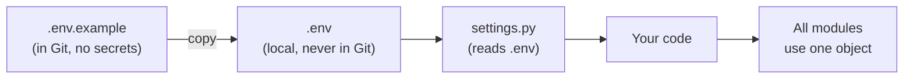
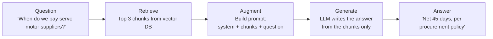
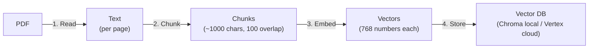
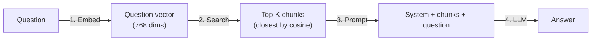
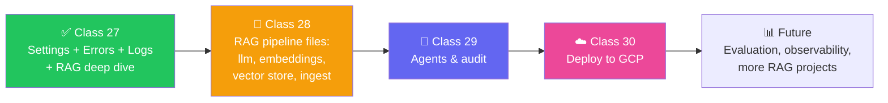
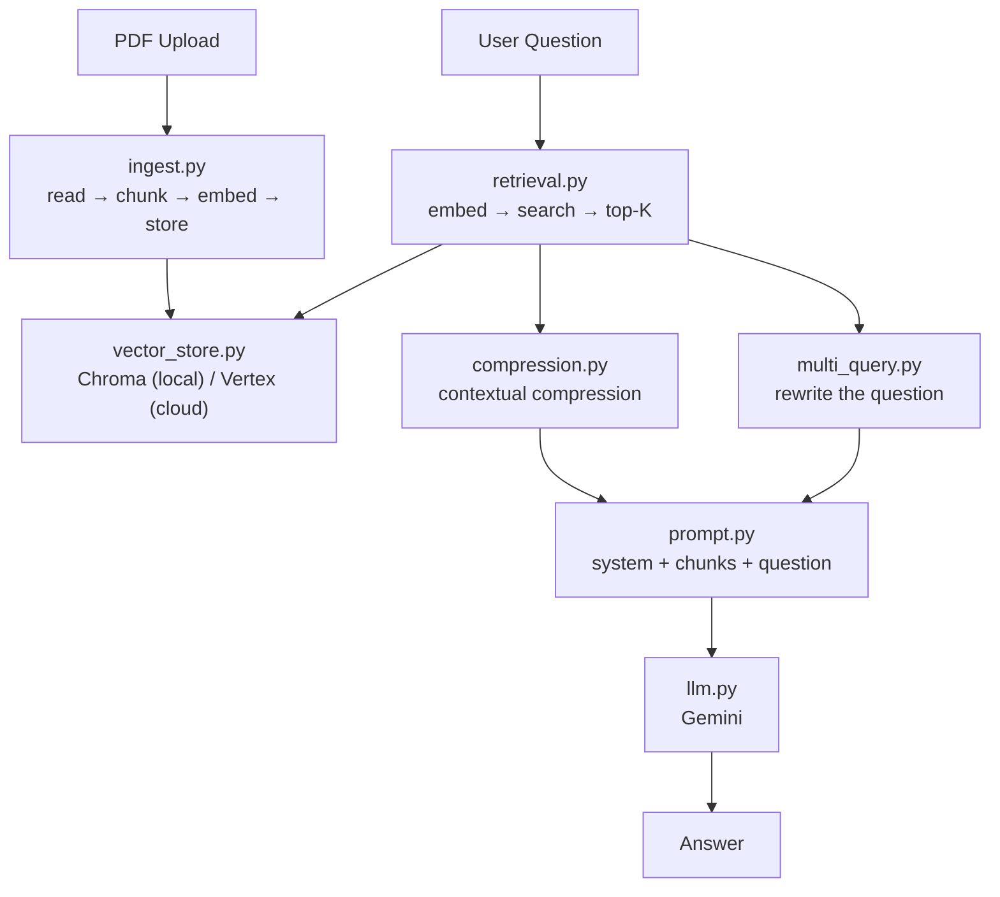

# ⚙️ Class 27: Settings, Error Handling, Logging & RAG Deep Dive — Building the Meridian AI Backbone

**Author:** Pragati  
**Course:** Agentic AI Specialization  
**Date:** 11 October 2026

---

## 📋 Table of Contents
1. [Quick Updates](#-quick-updates)
2. [Part 1: Settings & Configuration](#-part-1-settings--configuration)
3. [Why Settings Live Outside the Code](#-why-settings-live-outside-the-code)
4. [The `.env` and `.env.example` Pattern](#-the-env-and-envexample-pattern)
5. [Secrets Management Across Environments](#-secrets-management-across-environments)
6. [Getting Your Gemini API Key](#-getting-your-gemini-api-key)
7. [Building `settings.py`](#-building-settingspy)
8. [Testing the Settings](#-testing-the-settings)
9. [Part 2: Error Handling](#-part-2-error-handling)
10. [Custom Exceptions](#-custom-exceptions)
11. [Part 3: Logging](#-part-3-logging)
12. [The Custom Logger](#-the-custom-logger)
13. [Structured Logs](#-structured-logs)
14. [Part 4: RAG Deep Dive](#-part-4-rag-deep-dive)
15. [What Is RAG?](#-what-is-rag)
16. [Stage 1: Indexing](#-stage-1-indexing)
17. [Chunking — Splitting Documents](#-chunking--splitting-documents)
18. [Embeddings — Turning Text into Numbers](#-embeddings--turning-text-into-numbers)
19. [Stage 2: Retrieval & Generation](#-stage-2-retrieval--generation)
20. [Why RAG Beats Keyword Search](#-why-rag-beats-keyword-search)
21. [Visualizing the Vector Space](#-visualizing-the-vector-space)
22. [When RAG Goes Wrong](#-when-rag-goes-wrong)
23. [Types of RAG — A Complete Map](#-types-of-rag--a-complete-map)
24. [Choosing the Right RAG](#-choosing-the-right-rag)
25. [What Meridian AI Uses](#-what-meridian-ai-uses)
26. [Live Q&A Highlights](#-live-qa-highlights)
27. [Key Pointers to Remember](#-key-pointers-to-remember)
28. [Action Items](#-action-items)
29. [What's Next](#-whats-next)

---

## 📰 Quick Updates

- 🎯 **Today's scope:** This class covered two big areas — first, the **backbone** of the Meridian AI project (settings, secrets, error handling, logging), and second, a **deep dive into RAG** (Retrieval Augmented Generation) that goes well beyond what the project strictly needs, so you can talk about it confidently in interviews.
- 🩹 **Housekeeping:** The presentation was still being exported to a shareable format (it's built with React, not PowerPoint). The code and the repo link were shared, and the `.env.example` pattern was reinforced. Slides were promised by the next day.
- 🗺️ **Roadmap:** The project continues next class with the RAG pipeline files (`llm.py`, `embeddings.py`, `vector_store.py`, `ingest.py`, `retrieval.py`). After this project, there will be more RAG-based projects, then LangGraph, then more advanced topics.
- ⚠️ **Important:** The code was shared **before** this class. This session explained **why** each file exists and **how** it works — not just typing code line-by-line. If you haven't gone through the shared code, you will struggle with the next sessions.

---

## Part 1: Settings & Configuration

**Analogy:** Think of settings like the **electrical panel in a building**. Every room (module) needs power, but you don't want to run a separate wire from the street to every light bulb. You have one panel (`.env` + `settings.py`), and every room connects to it. Change the incoming power (environment variable), and the whole building adapts — without rewiring a single room.

### Why Settings Live Outside the Code

| Problem | What Happens When Hard-Coded |
|---|---|
| **Key in code, pushed to GitHub** | The key is public forever. Anyone can use it. |
| **Name in nine places** | Change the model name once — you must remember the other eight. |
| **Works on my machine** | Your path, keys, and choices differ from a colleague's. Code breaks on their laptop. |

> *"A key in the code pushed to GitHub — a key is public for good. A found key can be used by anyone."*

**Three ways hard-coded values hurt:**

1. **Leaked secrets** — your Gemini API key is exposed to the world.
2. **Duplicated config** — one value, many locations, guaranteed drift.
3. **Environment mismatch** — local works, cloud fails.

### The `.env` and `.env.example` Pattern



| File | Purpose | Pushed to Git? |
|---|---|---|
| **`.env`** | Real values — API keys, DB URLs, secrets | ❌ Never |
| **`.env.example`** | Template — shows what variables are needed | ✅ Yes |
| **`.gitignore`** | Lists `.env`, `.venv`, `logs/` | ✅ Yes |

**What `.env.example` contains (for Meridian AI):**

```env
APP_NAME=Meridian AI
APP_ENV=local
APP_MODE=local
GOOGLE_API_KEY=
LLM_MODEL_NAME=gemini-2.5-flash
LLM_TEMPERATURE=0.0
VERTEX_LLM_MODEL_NAME=
LOCAL_EMBEDDING_MODEL_NAME=gemini-embedding-001
LOCAL_EMBEDDING_DIMENSION=768
AGENT_MAX_MODEL_CALLS=8
AGENT_MAX_TOOL_CALLS=10
AGENT_MAX_RETRIES=2
GCP_PROJECT_ID=
GCS_BUCKET_NAME=
VECTOR_SEARCH_INDEX_ID=
VECTOR_SEARCH_INDEX_ENDPOINT=
```

**What `.env` contains (same file, filled in):**

```env
APP_MODE=local
GOOGLE_API_KEY=your-actual-gemini-key-here
LLM_MODEL_NAME=gemini-2.5-flash
LLM_TEMPERATURE=0.0
```

> *"Dot env is added into .gitignore. Like normally, we always and always make sure that dot env files are added. So Git does not push them up. And of course, that is important — we don't want Git to have your secrets."*

### Secrets Management Across Environments

**Analogy:** Think of it like **house keys**. At home, you keep a spare key under the mat (local `.env`). When you're at a hotel, the front desk holds your key (cloud secret manager). Same key, different storage.

| Environment | Where Secrets Live | How Code Reads Them |
|---|---|---|
| **Local** | `.env` on your machine | `pydantic-settings` reads `.env` |
| **GitHub Actions** | GitHub Secrets & Variables | Injected as env vars during CI/CD |
| **Google Cloud Run** | Secret Manager | Mounted as env vars at runtime |

> *"When I'm doing it on my local, all the things should be present on my .env. On the other hand, when I'm pushing it on, say, cloud — it can be over GitHub, it can be over GCP — then we have the different secret managers from which we have our value set up."*

**The beauty of this pattern:** The same code runs locally and on cloud. Only the **source** of the secret changes — the code never knows or cares.

### Getting Your Gemini API Key

**Steps:**

1. Go to **Google AI Studio** (`aistudio.google.com`).
2. Click the **"Get API key"** button.
3. Click **"Create API key"** — pick a project (or create a new one).
4. Copy the key once.
5. Paste it into your `.env` as `GOOGLE_API_KEY=...`.

**Free tier limits (as of the class):**

| Model | RPM (Requests/Min) | TPM (Tokens/Min) | RPD (Requests/Day) |
|---|---|---|---|
| Gemini Flash (free) | ~1K | ~1M | Generous |
| Gemini Pro (free) | Lower | Lower | Lower |

> *"It's free up to some limit — not overall. You can check the rate limit and everything. Mine is, account is a little messed up, honestly. But it gives you free as well."*

**Important notes:**

- The key is a **password**. Never paste it into chat, a screenshot, or a public repo. Use a **throwaway key** if you're recording.
- **Free-tier content may be used by Google to improve products** — always use **fictional sample documents**.
- You can use a different LLM (Groq, OpenAI, etc.), but you'll need to **change the code** — the project is wired for Gemini.
- **Vertex AI key ≠ Gemini API key.** If you're on GCP, use a Vertex AI service account, not the AI Studio key.

### Building `settings.py`

**Location:** `backend/config/settings.py`

**What the file must do:**

| Requirement | Why |
|---|---|
| **Read values** from `.env` | Central source of truth |
| **Give each a default** | So the app doesn't crash on missing optional values |
| **Enforce a type** | `LLM_TEMPERATURE` must be a float, not a string |
| **Refuse wrong values** | `APP_MODE` must be `local` or `cloud` — fail at startup, not later |
| **Offer one shared object** | Every module imports `settings` — no duplication |
| **Explain what's missing** | Clear error: "GCP_PROJECT_ID is empty" |

**Structure (high level):**

```python
from pydantic_settings import BaseSettings
from pydantic import Field
from typing import Literal
from pathlib import Path

PROJECT_ROOT = Path(__file__).resolve().parent.parent.parent

class Settings(BaseSettings):
    # App metadata
    app_name: str = Field(default="Meridian AI")
    app_env: str = Field(default="local", alias="environment")
    app_version: str = Field(default="0.1.0")
    app_mode: Literal["local", "cloud"] = Field(default="local")

    # LLM
    google_api_key: str = Field(default="")
    llm_model_name: str = Field(default="gemini-2.5-flash")
    llm_temperature: float = Field(default=0.0)

    # Embeddings
    local_embedding_model_name: str = Field(default="gemini-embedding-001")
    local_embedding_dimension: int = Field(default=768)

    # Agent limits
    agent_max_model_calls: int = Field(default=8)
    agent_max_tool_calls: int = Field(default=10)
    agent_max_retries: int = Field(default=2)

    # Cloud (optional for local)
    gcp_project_id: str = Field(default="")
    gcs_bucket_name: str = Field(default="")

    class Config:
        env_file = PROJECT_ROOT / ".env"
        extra = "ignore"

settings = Settings()
```

**Key concepts explained:**

| Concept | What It Means |
|---|---|
| `BaseSettings` | A Pydantic class that reads fields from env vars and `.env` |
| `Literal["local", "cloud"]` | Only these two values are allowed — anything else fails at startup |
| `Field(alias="environment")` | The Python name is `app_env`, but `.env` uses `environment` |
| `PROJECT_ROOT` | `Path(__file__).resolve().parent.parent.parent` — walks up from `backend/config/settings.py` to the project root |
| `env_file` | Tells Pydantic where to find `.env` |
| `settings = Settings()` | The single shared object — every module imports this |

> *"If you're having a doubt around validation alias — copy the code and ask ChatGPT. It's just for validating the value from the case. Very simple — just we are using Pydantic, nothing else."*

**Helper properties:**

```python
    @property
    def is_cloud(self) -> bool:
        return self.app_mode == "cloud"

    @property
    def chroma_directory(self) -> Path:
        return PROJECT_ROOT / ".meridian" / "chroma"

    @property
    def upload_directory(self) -> Path:
        return PROJECT_ROOT / ".meridian" / "uploads"

    @property
    def missing_cloud_settings(self) -> list[str]:
        missing = []
        if not self.gcp_project_id:
            missing.append("GCP_PROJECT_ID")
        if not self.gcs_bucket_name:
            missing.append("GCS_BUCKET_NAME")
        return missing
```

> *"Every module that touches storage asks `settings.is_cloud` instead of guessing. Switching modes is one line in `.env`."*

### Testing the Settings

```bash
cd backend
uv run python -c "from config.settings import settings; print(settings.app_mode)"
# Output: local
```

**Test 1: The key works**

```bash
uv run python -c "
from config.settings import settings
from langchain_google_genai import ChatGoogleGenerativeAI
llm = ChatGoogleGenerativeAI(
    model=settings.llm_model_name,
    google_api_key=settings.google_api_key,
)
print(llm.invoke('hello'))
"
```

Output: `Hello` — because the API call is actually hitting Gemini with the key from `.env`.

**Test 2: Remove the key from `.env`, run again**

Output:
```
Error: UNAUTHENTICATED
```

**Test 3: Put the key back, run again**

Output: `Hello` again.

> *"So what happened if I have to quickly explain this — from config.settings import settings. First line. From langchain_google_genai import ChatGoogleGenerativeAI. And then finally print llm. Model, settings.llm_model_name. API key I'm using from settings.google_api_key. And I'm just invoking the same."*

**What this proves:** The code **never hardcodes** the key. It reads it from `settings`, which reads it from `.env`. Change the key in `.env` — no code change needed. Deploy to cloud — swap the source to Secret Manager, again no code change.

---

## Part 2: Error Handling

**Analogy:** Think of error handling like **hospital triage**. When something goes wrong, you don't want a wall of text that says "everything is broken." You want one clear sentence: "This is what's wrong, this is what to do." The specialist (doctor) then looks at the detailed chart (logs) for the full story.

**Without clear errors:**

```
Traceback (most recent call last):
  File "main.py", line 87, in <module>
    ...
ModuleNotFoundError: No module named 'xyz'
```

Which line matters? Is it a bug or a missing setting? You have no idea.

**With clear errors:**

```
ConfigurationError: GOOGLE_API_KEY is empty. Add it to .env.
```

One sentence. Tells you what's wrong and what to do.

### Custom Exceptions

**Location:** `backend/exceptions/exceptions.py`

```python
class MeridianError(Exception):
    """Base class for all Meridian AI errors."""

class ConfigurationError(MeridianError):
    """A required setting is missing or invalid."""

class IngestionError(MeridianError):
    """A document could not be read or indexed."""

class RetrievalError(MeridianError):
    """A query could not be processed."""

class AgentExecutionError(MeridianError):
    """An agent run failed."""
```

**Why a hierarchy?**

- **`MeridianError`** is the base — every Meridian error is one of these.
- **`ConfigurationError`** → HTTP 503 (a setting is missing — no API key, no bucket)
- **`IngestionError`** → HTTP 422 (a PDF couldn't be read)
- **`AgentExecutionError`** → HTTP 500 (an agent failed)

**The API layer maps each error to a clean HTTP status:**

| Exception | HTTP Status | When It Happens |
|---|---|---|
| `ConfigurationError` | 503 Service Unavailable | `GOOGLE_API_KEY` is empty |
| `IngestionError` | 422 Unprocessable Entity | PDF could not be parsed |
| `MeridianError` (generic) | 500 Internal Server Error | Anything else |

> *"From exception, I created one which is known as Meridian error. And now all of my errors will further just extend from this particular one. So, kind of using the class and OOP here."*

**Quick test:**

```bash
uv run python -c "
from exceptions.exceptions import ConfigurationError, MeridianError
print(issubclass(ConfigurationError, MeridianError))
"
# Output: True
```

---

## Part 3: Logging

**Analogy:** Think of logging like a **diary for developers**. Users see clean messages ("Something went wrong"). Developers see a full timeline: "At 02:15:37, the agent called the FX tool, which took 105 ms and returned 163.0." Same event, two audiences.

**Why not just `print`?**

| `print` | Logging |
|---|---|
| No timestamp | Timestamp on every line |
| No severity | `INFO`, `WARNING`, `ERROR` |
| No structure | JSON — searchable, filterable |
| Console only | Console + file + cloud |
| Deleted on restart | Persisted per run |

> *"When we do logging, then automatically log script print on the terminal, then why separate print? The reason is that because you will not be always scrolling back to terminal and everything. Plus, we have to make sure that we give it on console properly."*

### The Custom Logger

**Location:** `backend/logger/custom_logger.py`

**What it does:**

| Step | What Happens |
|---|---|
| **1. Create log directory** | `logs/` folder created if missing |
| **2. One file per run** | `logs/meridian_2026-10-18_14-32-45.log` |
| **3. File handler** | Every line written to the log file |
| **4. Console handler** | Same line printed to the terminal |
| **5. Structured format** | JSON with timestamp, level, severity, event |
| **6. Cloud-ready** | `severity` field is read by GCP Cloud Logging |

**Structured log line (example):**

```json
{
  "timestamp": "2026-10-18T14:32:45.123Z",
  "level": "info",
  "severity": "INFO",
  "event": "tool_call_finished",
  "tool": "validate_fx",
  "duration_ms": 105
}
```

> *"A structured log line is much better than a plain message. Tool call finish, validate FX, 105 milliseconds. The `severity` field is what cloud logging uses to color and filter lines."*

**At exit (cloud mode only):**

```python
import atexit
atexit.register(self._flush_to_gcs)
```

When the app shuts down, the log file is **uploaded to Google Cloud Storage**. In local mode, it just stays on disk.

> *"At exit, copy the file to the cloud bucket, cloud mode only. So that is where atexit is used. I honestly have never written it myself — maybe I've copied it. Because in our companies, we used to extend the company loggers, or use the company's custom loggers."*

**Usage:**

```python
from logger import global_logger as log

log.info("user_uploaded_file", file_name="policy.pdf", size_kb=245)
log.warning("slow_retrieval", query="payment terms", duration_ms=2100)
log.error("tool_failed", tool="check_sanctions", error="timeout")
```

**Testing the logger:**

```bash
cd backend
uv run python -c "
from logger import global_logger as log
log.info('step_3_hello', message='Hello from the logger!')
"
```

A new file appears in `backend/logs/`, and the same line is printed to the terminal.

### Structured Logs

**Why JSON matters:**

| Field | Used For |
|---|---|
| `timestamp` | Ordering, debugging timelines |
| `level` | Filtering — show only errors in production |
| `severity` | Cloud Logging colors: `INFO` = blue, `ERROR` = red |
| `event` | What happened — searchable |
| `duration_ms` | Finding slow calls (e.g., "show all tool calls > 500ms") |
| `tool`, `model`, `agent` | Which component was involved |

> *"In production, we just show the error and debug logs. In dev, we show all the logs. That is where the severity is needed."*

**Committing the backbone:**

Once settings, exceptions, and logger are in place, **make your first commit**:

```bash
git add -A
git commit -m "Backbone: settings, exceptions, structured logger"
```

> *"Committed the backbone — ideally, now is the time where you can commit it."*

---

## Part 4: RAG Deep Dive

**Analogy:** Think of RAG like an **open-book exam**. In a closed-book exam, you rely only on what you memorized (the LLM's training). In an open-book exam, you **find the right page** (retrieval), **read it** (augmentation), and **write your answer** (generation). That's exactly what RAG does.

### What Is RAG?

**RAG = Retrieval Augmented Generation** — retrieve first, then generate.

**The problem it solves:** An LLM has never seen your company's documents. Ask it "What payment terms do servo motor suppliers get at Aldermoor?" and you get a generic answer — or worse, a confident wrong one. Your company's actual policy is in a PDF nobody uploaded to the model's training.

**The open-book analogy, step by step:**

| Step | Open-Book Exam | RAG |
|---|---|---|
| **1. Find the page** | You scan the index or table of contents | Search the vector DB for similar chunks |
| **2. Read the page** | You read the relevant section | You pass the retrieved chunks as context |
| **3. Write the answer** | You write the answer from that section | The LLM generates from the context |



**Without RAG (generic answer):**

> *"Public information specifically detailed procurement terms or payment terms, depending on the context. Here is how this typically breaks down…"*

**With RAG (grounded answer):**

> *"Vendors with a credit score of 75 or higher are low-risk and receive standard net 45 payment terms."*

> *"Look it up, then answer. Find the pages. Build a prompt — pages and question together. Model answers. And then you finally get the answer. RAG — Retrieval Augmented Generation — retrieve first, then generate."*

---

### Stage 1: Indexing

**This happens once per document** — when you upload a PDF. It has four steps:



| Step | What Happens | Why |
|---|---|---|
| **1. Read** | `pypdf` extracts text from every page | The model can't read PDFs directly |
| **2. Chunk** | `RecursiveCharacterTextSplitter` cuts into ~1000-char chunks, 100-char overlap | A page can be too long for one embedding |
| **3. Embed** | The embedding model turns each chunk into **768 numbers** | Text can't be compared mathematically |
| **4. Store** | Chroma saves the chunk + its 768 numbers + metadata | For later similarity search |

**Stable IDs:** Each chunk gets an ID derived from `file_name + page + position`. Re-indexing the same file **replaces** the chunk instead of duplicating it.

> *"A stable ID means that indexing the same file again replaces the chunk instead of copying them."*

---

### Chunking — Splitting Documents

**Analogy:** Think of chunking like **dividing a textbook into chapters**. You don't read the whole book when the exam asks about one topic — you go to the right chapter. But you also don't make every sentence its own chapter — you'd lose context.

**Why chunk at all?**

| Too big | Too small |
|---|---|
| Embedding loses fine detail | Loses context |
| Prompt gets huge | Answer becomes vague |
| Cost goes up | More chunks = slower retrieval |

**The sweet spot:** ~500–1000 characters per chunk, with ~10% overlap.

**Overlap, visualized:**

```
Chunk 1: [====== 300 chars ======]
Chunk 2:                 [====== 300 chars ======]
                          ^^^^^ overlap ^^^^^
```

The overlap ensures that if a sentence is cut across a boundary, both chunks have enough context to be understood. They also end up **closer in vector space** because they share tokens.

> *"Overlap helps us to make sure that these two chunks, because they're one after the other, they will have something in common, so they are closer to each other in the vector space."*

**Chunking strategies:**

| Strategy | How It Works | Best For |
|---|---|---|
| **Fixed-size** | Every chunk is exactly 300 chars (or 500 tokens) | Simple, predictable |
| **Recursive character** | Split by `\n\n`, then `\n`, then sentence, then char — respects natural breaks | Most documents (default) |
| **Document-aware** | Split by headers/sections (Markdown, HTML) | Structured documents |
| **Semantic** | Split where meaning changes (embedding distance) | Narrative text |
| **Parent-child** | Small chunks for search, but return the parent chunk for context | Long documents |
| **Agentic** | LLM decides where to split | Complex, varied documents |

> *"If you go on Google and search for chunking strategies for RAG — fixed size, recursive character, document-aware, semantic, parent-child hierarchical, agentic LLM-driven. Now, to take this decision, you can go to Claude or ChatGPT and ask them: 'What is the best one for my data?'"*

**Interactive chunking tool demo:**

The class showed a **live visualization** where you can:

- Adjust chunk size with a slider (from 1 to 1000+ chars)
- Adjust overlap
- See each chunk highlighted in a different color
- See stats: number of chunks, average size, largest chunk, total overlap

**Fixed vs. recursive, side by side:**

| Fixed-size | Recursive |
|---|---|
| Chunk 1: exactly 300 chars | Chunk 1: 297 chars (broke at a period) |
| Chunk 2: exactly 300 chars | Chunk 2: 232 chars (broke at a paragraph) |
| Chunk 3: exactly 300 chars | Chunk 3: 140 chars (broke at a line break) |

> *"The chunk 3 is having 140 characters because here there was a break — so very logical break. If I make it a fixed size, it will also have 300 characters. But which means that these documents might not be related, so ideally these two should not come as a single chunk. So, in that case, recursive."*

**How to choose your chunk size:**

1. Start with **500–1000 chars**, 10% overlap.
2. Test retrieval on a few questions.
3. If answers miss context → **increase chunk size** (or use parent-child).
4. If answers are vague → **decrease chunk size**.
5. If you're unsure → **ask an LLM**: "Here's the kind of data I have — what chunk size do you recommend?"

---

### Embeddings — Turning Text into Numbers

**Analogy:** Think of embeddings like **GPS coordinates for meaning**. Every sentence gets a point in a 768-dimensional space. Sentences about the same thing end up close together — even if they share no words.

**How it works:**

```
"What are the payment terms for servo motors?"  →  [0.12, -0.45, 0.88, ..., 0.03]  (768 numbers)
"Vendors receive net 45 day terms."              →  [0.11, -0.43, 0.91, ..., 0.01]
"Valve maintenance schedule is quarterly."      →  [-0.72, 0.31, -0.14, ..., 0.65]
```

- The first two points are **close** (both about payment terms).
- The third is **far away** (different topic).

**Cosine similarity** measures the angle between two vectors:

| Score | Meaning |
|---|---|
| **1.0** | Identical meaning |
| **~0.9** | Very similar |
| **~0.5** | Related but different |
| **0.0** | Unrelated |

> *"Two sentences about payment terms get numbers that point in nearly the same direction. Closeness is a number. The usual measure is cosine similarity — one is identical direction, zero is unrelated."*

**Why 768 dimensions?**

- Embedding models are trained to output a fixed dimension (768, 1024, 1536, etc.).
- It's a trade-off: more dimensions = more nuance, but more storage and slower search.
- **Gemini's `gemini-embedding-001`** outputs 768 by default. You can change it, but 768 is a good default.

**Same model for indexing and querying — critical!**

> *"The same embedding model turns the query into 768 numbers. It must be the same model as the indexing one, or the numbers cannot be compared. When you're preparing for an open-book exam, you should be the one who reads the book completely, so that during the exam you can go exactly where you want to go. If your friend has read the book and you are giving the exam, these are two different models. Your brain now doesn't know where you will find this particular answer."*

| Index with | Query with | Result |
|---|---|---|
| Gemini | Gemini | ✅ Works |
| Gemini | Snowflake | ❌ Nonsense |
| OpenAI | Gemini | ❌ Nonsense |

---

### Stage 2: Retrieval & Generation

**This happens on every question.** Three steps:



**Step 1: Embed the query** — Same model as indexing.

**Step 2: Search** — Compare the query vector to all stored chunk vectors. Pick the **top K** (usually 3–10).

**Step 3: Build the prompt.**

```text
SYSTEM:
You are a helpful assistant for question-answering tasks.
Use the following pieces of retrieved text to answer.
If you don't know the answer from the context, say "I don't know."
Keep the answer concise and accurate.

CONTEXT:
[Chunk 1]
[Chunk 2]
[Chunk 3]

QUESTION:
When do we pay servo motor suppliers?
```

**Step 4: Generate** — The LLM writes the answer **from the context only**. Temperature is set very low (0.0) for determinism.

> *"If you don't give it the instruction like 'you are helpful assistant, use the following pieces of retrieved text' — if you remove the instruction, it will try to go a little bit ahead. Normally, we keep the temperature very close to zero, so it's not playing around and gives the exact answer every time."*

**What removing the instruction does:** The model answers from its own knowledge, not from the chunks — and often gets it wrong for company-specific questions.

---

### Why RAG Beats Keyword Search

**Analogy:** Keyword search is like a **dictionary** — you find exact words. RAG is like a **librarian who understands what you mean** — you can ask a clumsy question and still get the right book.

**The demo:**

| Query | Keyword Search | RAG |
|---|---|---|
| "When do we pay servo motor supplies?" | Finds chunks with "servo" — but not necessarily the payment terms | Finds chunks about **payment terms**, even if "servo" doesn't appear |
| "Who has to approve a very expensive order?" | Misses — the document says "purchases above €1 million" | Finds it — both mean the same thing |
| "What happens if a supplier is a financial risk?" | Sometimes works | Always works |

> *"In keyword search, you will search for 'servo motors'. But if you go by the meaning, then you will be able to actually get the same. Vendors with a credit score of 75 or higher are low-risk and receive standard net 45 payment terms."*

**The class showed a real benchmark:** 4 questions run against 4 documents.

| Question | Keyword Found? | RAG Found? |
|---|---|---|
| When do we pay servo motor suppliers? | ❌ | ✅ |
| Who approves a very expensive order? | ❌ | ✅ |
| What happens if a supplier is a financial risk? | ✅ | ✅ |
| Do we pay custom duty on a control unit from Tokyo? | ❌ | ✅ |

**Score: Keyword 1/4, RAG 4/4.**

> *"It's not that RAG is the one way to fit it all or answer everything, but RAG is much better because in the meaning case, we were able to find each and everything."*

---

### Visualizing the Vector Space

**The interactive tool:** RAG Visualization Workshop (`https://blog.langchain.dev/rag-visualization/` or similar).

**What you see:**

| Part of the screen | What It Shows |
|---|---|
| **Left: Chunks** | Each chunk is a colored dot |
| **Right: 2D map** | Each dot is plotted by its embedding |
| **Query** | A new dot appears — closest chunks are linked |
| **Top K** | The K closest chunks are listed with similarity scores |

**Why 2D?** The vectors are 384 or 768 dimensions — you can't plot that. A technique called **UMAP** squeezes them into 2D so you can see them.

> *"UMAP squeezes hundreds of dimensions into 2D so you can see them. Otherwise, there was a 384-dimensional graph. Can you plot a 384-dimension graph? You can create it, but plotting is very difficult."*

**A caution:** The 2D positions are approximate. The nearest-looking dot might not be the actual best match.

> *"2D positions are approximate, so the closest-looking chunk may not be the best matches."*

**Real example shown:** The Chhattisgarh Class 11 Maths book.

| Chapter | Topic | Sent to LLM? |
|---|---|---|
| Ch 10 | Conic Sections | ❌ (unless related) |
| Ch 11 | **3D Geometry** | ✅ (the question is about 3D) |
| Ch 12 | Limits and Derivatives | ❌ (different topic) |
| Ch 13 | Probability | ❌ (different topic) |

Even within Ch 11, only the chunk about "coordinates of a point in space" is retrieved, not the whole chapter.

> *"If I'm asking the question specific to coordinate of a point in space to my LLM — if I am able to send this information to my LLM, it will give a very good answer. And that is what actually happens in RAG."*

---

### When RAG Goes Wrong

**Analogy:** Think of RAG going wrong like a **student in an open-book exam who still gets the answer wrong** — maybe they read the wrong page, or the page was cut off mid-sentence, or they mixed two chapters.

**The failure modes:**

| Symptom | Cause | Fix |
|---|---|---|
| **Confident but wrong** | Right chunk not retrieved (or wrong chunk came first) | Look at the chunks before blaming the model; try a different search mode, larger K, or a re-ranker |
| **"I don't know" — but the file has the answer** | Chunk not found — wrong chunk size, scanned PDF (no text), or very different wording | Check the PDF has real text; try smaller chunks; try multi-query |
| **Answer mixes two documents** | Chunks from different topics came back together, model joined them | Smaller K; re-rank; filter by source; contextual compression |
| **Answer ignores the files** | Prompt does not force the model to stay inside the context | Strengthen the prompt ("if not in context, say I don't know") |
| **Answer got worse after changing embedding model** | Chunks indexed with one model, queries embedded with another | Re-index everything with the new model — never mix |
| **Same sentence appears twice** | Same file indexed twice with random IDs | Use stable IDs (file + page + position) |
| **Answers are slow** | Each extra step (query rewrite, trimming, re-ranking) adds a model call | Use plain similarity unless the question needs more |
| **Key sentence is cut in half** | Chunk boundary fell in the middle of the sentence | Use overlap; use recursive splitter; keep chunks large enough for the whole idea |

> *"When RAG goes wrong — the answer is confident but wrong. The right chunk was not retrieved or a near miss came first, so the model answered from wrong text. What to try? Look at the chunks before blaming the model. Then try a different search mode, a larger K, or a re-ranker."*

**Debugging checklist:**

1. **Look at the chunks first** — before blaming the LLM, check what was retrieved. Are the right chunks there?
2. **Check the PDF** — is it a scanned image? Does it have real text?
3. **Check the chunk size** — is a key sentence cut in half?
4. **Check the embedding model** — same model for indexing and querying?
5. **Check the prompt** — does it say "use only the context"?
6. **Check for duplicates** — same file indexed twice?

---

### Types of RAG — A Complete Map

**Analogy:** Think of RAG types like **ways to study for an open-book exam**. You can re-read the question in different ways (multi-query), imagine what the answer looks like (HyDE), split complex questions into parts (decomposition), and check if you found the right page (corrective). Each solves a specific failure.

**Basic RAG — the baseline:**

```
Question → Search top-K → Prompt → Answer
```

**Works when:**
- Question and text share words or meaning
- The right chunk comes first
- The wording matches

**Fails when:**
- Question uses different words than the document
- The right chunk is third, not first
- A chunk carries noise or misses the sentence before it

**Variations — improvement at four points:**

| When | Strategy | What It Does |
|---|---|---|
| **Before search** | Multi-query | LLM rewrites the question in 3 different ways; search all; merge |
| **Before search** | HyDE | LLM imagines an answer; search with the imagined answer instead of the question |
| **Before search** | Query decomposition | Split a two-part question into two; search each |
| **Before search** | Follow-up rewrite | Make a follow-up question standalone (so "what about the other one?" becomes a full question) |
| **During search** | Hybrid search | Keyword + semantic together; fuse results |
| **During search** | MMR (Maximum Marginal Relevance) | Pick chunks that are relevant **but different** — no duplicates |
| **During search** | Parent pages | Search small chunks, but return the whole parent page |
| **After search** | Re-ranking | Fetch 20, let a stronger model order them, keep top 3 |
| **After search** | Contextual compression | Trim each chunk to only the sentences that matter |
| **After search** | Corrective RAG | Grade the chunks; if poor, rewrite the question and try again |
| **Beyond search** | Agentic RAG | The agent decides **whether to search at all**, **what to search**, and **whether to search again** |
| **Beyond search** | Graph RAG | Documents become a graph of entities and relations; search follows the graph |
| **Beyond search** | Multimodal RAG | Images, tables, and charts are indexed too — not just text |
| **Beyond search** | Adaptive RAG | A classifier decides if a simple or complex strategy is needed |

**The five-line summary:**

> *"Basic RAG is the baseline. Improve it in four places — multi-query, HyDE, and query decomposition before the search; hybrid, MMR, and parent pages during the search; re-ranking, contextual compression, and corrective after the search; all with a bigger structure around it, which is agentic RAG and everything. Start simple and then measure."*

**Deep dive: Multi-query RAG**

| Step | What Happens |
|---|---|
| 1 | Question: "What payment terms do the servo motor get?" |
| 2 | LLM rewrites it 3 ways: "What are typical payment conditions?", "What payment terms are standard?", "What kind of payment arrangements are there?" |
| 3 | Search all 4 (original + 3 rewrites) |
| 4 | Merge results, remove duplicates |
| 5 | Send top-K to LLM for the answer |

**Cost:** One extra LLM call + 3 extra searches. In the demo, the answer took **12 seconds instead of 7**.

**Deep dive: Contextual compression**

| Step | What Happens |
|---|---|
| 1 | Fetch top 10 chunks |
| 2 | For each chunk, the LLM extracts **only the sentences that matter** |
| 3 | Send the trimmed chunks to the LLM |

**Cost:** One small model call per chunk (10 calls for 10 chunks). **Benefit:** the prompt is much shorter, so the model is less distracted.

**Deep dive: HyDE**

| Step | What Happens |
|---|---|
| 1 | Question: "When do we pay servo motor suppliers?" |
| 2 | LLM **imagines an answer**: "Vendors with a credit score of 75+ get net 45 terms." |
| 3 | Embed the **imagined answer** (not the question) |
| 4 | Search with the imagined answer's vector |
| 5 | Use the real chunks for the final answer |

**Why it works:** A short question and a long policy sentence are far apart in meaning space. The imagined answer has more words in common with the real answer, so its vector is closer.

**Catch:** The imagined answer may be wrong — it's **only used to search**, never shown or trusted.

> *"When you were asked something in the exam, you used to write anything and have those words and everything which might be related. So you used to get some marks. In a similar sense, we come up with some answer, and of course, this answer will have much better words like contract, terms — so the vector which will be created might be very close to the one which we are looking for."*

**Deep dive: Adaptive RAG**

| Step | What Happens |
|---|---|
| 1 | A small classifier looks at the question |
| 2 | Simple question → **single retrieval** |
| 3 | Complex question → **multi-step retrieval** (search, evaluate, search again) |
| 4 | The classifier can also decide: "no retrieval needed" (for chit-chat) |

> *"Our aim in adaptive RAG is to make sure that we can give the best overall answer, even if you have to go to the overall thing multiple times. Normally, we have a classifier — a very small model, not a heavy model — which tells you that this is a complex query or a simple query. Based on that, we do multiple retrieval or a single retrieval."*

---

### Choosing the Right RAG

**Analogy:** Think of this table like a **doctor's prescription chart**. Symptom in, treatment out. Don't guess — match the symptom to the fix.

| Symptom | First thing to try |
|---|---|
| Users phrase questions differently from the documents | **Multi-query** or **HyDE** |
| Questions have two or more parts | **Query decomposition** |
| People ask follow-up questions in a chat | **Follow-up rewrite** |
| Exact names, codes, or IDs are missed | **Hybrid search** |
| The right chunk is found, but not first | **Re-ranking** |
| Chunks are longer and noisy | **Contextual compression** |
| Top results are near-copies of each other | **MMR** |
| You need the text around the match | **Parent pages** |
| The model answers even when the documents don't cover it | **Corrective RAG** |
| The task needs several steps or tools | **Agentic RAG** |
| Queries are about links between things | **Graph RAG** |
| Key facts sit in tables, charts, or scans | **Multimodal RAG** |

**Real-world experience shared:**

> *"In real-life use cases, I normally have a re-ranker, and I try to do quality composition. After that, when the result doesn't come, then I sit back and understand. In one of the last projects, we used three strategies: re-ranker, normal query decomposition, and semantic matching. We were filtering the documents a bit better with metadata — for example, from the brand, since I got the brand of the car, I was able to filter out the wrong document."*

**Why not use all of them at once?**

> *"That will be an overkill in a real production use case. You have to understand — there are reasons when it is clear. We know that when something will be better, it's better to use that only. My aim is to make sure that we can get the right data to our model. RAG just has to do with this."*

---

### What Meridian AI Uses

Meridian AI uses **three RAG strategies**, working together:

| Strategy | Role in Meridian AI |
|---|---|
| **Basic RAG** | The default — retrieve top-K chunks, prompt, answer |
| **Contextual compression** | Trim chunks to the relevant sentences — reduces noise and prompt size |
| **Multi-query** | Rewrite the question in 3 ways — handles vague questions like "when do we pay servo motors?" |

> *"What Meridian uses in the project — we are using this: normal, contextual compression, and multi-query. So three strategies."*

**Why only three?** Because the project is deliberately **focused**, not feature-rich. Adding all 14 RAG types would be over-engineering.

> *"The best way to do nothing is to do everything. So let's keep the project still till the point where we are able to understand and expand on it."*

**In the code:**

| File | RAG Strategy |
|---|---|
| `backend/rag/retrieval.py` | Basic retrieval — `similarity_search` with `k=5` |
| `backend/rag/compression.py` | `ContextualCompressionRetriever` with `LLMChainExtractor` |
| `backend/rag/multi_query.py` | `MultiQueryRetriever` — rewrites the query 3 ways |

**Configuration in `.env`:**

```env
RETRIEVAL_TOP_K=5
USE_CONTEXTUAL_COMPRESSION=true
USE_MULTI_QUERY=true
```

Change these values, restart, and the RAG strategy adapts. No code change.

---

## 💬 Live Q&A Highlights

| Question | Answer |
|---|---|
| **What's the difference between `.env`, `.env.example`, and `.env.company`?** | `.env` holds real secrets (never in Git). `.env.example` is the template (in Git, no secrets). `.env.company` was just a demo — you can create `.env.prod`, `.env.dev`, etc., and point to the right one. |
| **If we don't push `.env`, how does the cloud get the key?** | Cloud uses **Secret Manager** (GCP), **GitHub Secrets** (Actions), or env vars injected at runtime. Same code, different source. |
| **What is `app_mode`?** | A switch: `local` or `cloud`. It tells the code which paths, models, and storage to use. Change one line in `.env` — the whole app adapts. |
| **Can I use Groq or OpenAI instead of Gemini?** | Yes, but you must **change the code** — the project imports `langchain_google_genai`. Not a one-line swap. |
| **Can I use OpenAI with Google Cloud?** | Yes — Google Cloud can host any model. But the code must reference the right client library. |
| **Is the Gemini key free?** | Free up to a limit — check the rate limits in AI Studio. For real projects, you'll want billing enabled. |
| **Why do we need both `requirements.txt` and `requirements-dev.txt`?** | `requirements.txt` is for production — what the live app needs. `requirements-dev.txt` adds pytest and httpx for testing. The live server should not carry test tools. |
| **Why a custom logger instead of `print`?** | `print` has no timestamp, no severity, no structure, no file. Logging gives you a searchable JSON diary — console + file + cloud. |
| **What is `severity` for?** | Cloud Logging uses it to **color and filter** lines — `INFO` = blue, `ERROR` = red. In production, you show only errors. In dev, you show everything. |
| **What does `atexit` do?** | Registers a function to run when the app shuts down. In cloud mode, it uploads the log file to GCS. |
| **What is RAG in one sentence?** | Look it up, then answer. Retrieve relevant chunks from your documents, then generate the answer from those chunks only. |
| **What are the two stages of RAG?** | **Indexing** (once, when uploading a document) and **retrieval** (every time a question is asked). |
| **Why chunk at all?** | A page can be too long for one embedding. Chunks keep each embedding focused and the prompt small. |
| **What's the best chunk size?** | No fixed number — 500–1000 chars, 10% overlap is a good start. Test, then adjust. If answers miss context, increase. If answers are vague, decrease. |
| **Why overlap between chunks?** | So a sentence cut at a boundary is still understood. Overlap also puts related chunks close in vector space. |
| **What is an embedding?** | A list of 768 numbers that captures the **meaning** of a chunk. Similar meanings → similar numbers. |
| **Why 768 dimensions?** | It's what the model outputs by default. More dimensions = more nuance, but more storage and slower search. |
| **What is cosine similarity?** | A number between 0 and 1 that measures how close two vectors point in the same direction. 1 = identical, 0 = unrelated. |
| **Does the same embedding model need to be used for indexing and querying?** | **Yes, always.** Otherwise the numbers can't be compared — like your friend reading the book and you writing the exam. |
| **What is UMAP?** | A technique to squeeze high-dimensional vectors into 2D so you can visualize them. The 2D positions are approximate — nearest-looking may not be best match. |
| **What is top-K?** | The number of chunks returned by similarity search. Usually 3–10. More chunks = more context, but slower and more expensive. |
| **What is re-ranking?** | Fetch many chunks (e.g., 20), let a stronger model order them, keep the top 3. Improves precision. |
| **What is contextual compression?** | Trim each chunk to only the sentences relevant to the question. Reduces prompt size and noise. |
| **What is multi-query RAG?** | The LLM rewrites the question 3 ways, searches all 4 (original + 3), merges results. Great for vague questions. |
| **What is HyDE?** | The LLM imagines an answer, and you search with that imagined answer's vector instead of the question's. The imagined answer may be wrong — it's only used to search. |
| **What is adaptive RAG?** | A classifier decides if the question is simple (single retrieval) or complex (multi-step retrieval). Can also decide "no retrieval needed." |
| **What is graph RAG?** | Documents become a graph of entities and relations. Search follows the graph. Great when the answer is about **links** between things. |
| **What is multimodal RAG?** | Images, tables, and charts are indexed too — not just text. Needs a multimodal embedding model. |
| **How do I choose the right RAG?** | Match the **symptom** to the **fix** (see the table above). Start simple, measure, then add. Don't use all of them at once — that's over-engineering. |
| **Can I implement all RAG types in one pipeline?** | You can, but it's **overkill** in production. Each adds latency and cost. Use the one that solves your actual symptom. |
| **What is a hallucination in RAG?** | The model answers confidently but wrongly — often because the right chunk wasn't retrieved, or two documents were mixed, or the prompt didn't force it to stay in context. Fix: look at the chunks first, then adjust chunk size, K, re-ranker, or prompt. |
| **Can I use RAG with images and scanned PDFs?** | Yes — but you need a multimodal embedding model. A normal embedding model doesn't understand images. The whole approach changes. |
| **Can I run RAG completely offline?** | Yes, but you need a local embedding model and a local LLM. For images and scans, you need a **large** multimodal model — likely a company-server, not a laptop. |
| **How do I mask PII before embedding?** | Before sending chunks to the embedding model, run a regex or a simple model over each chunk and mask emails, phone numbers, Aadhaar numbers, etc. Chunks themselves are safe on disk — the risk is when they go to the embedding API. |
| **What is HNSW?** | Hierarchical Navigable Small World — an indexing technique used by vector DBs to speed up similarity search. More on this in the RAG project. |
| **What is observability?** | Logging + tracing + metrics for LLM systems. Tools like LangSmith, Logfire, OpenTelemetry. Will be covered in a later project. |
| **Is a router the same as a handoff?** | (Review from Class 25) No — a router classifies once and fans out; a handoff transfers the conversation to a specialist who replies directly. |
| **What is the difference between AI Engineer and FDE?** | (Review from Class 26) AI Engineer builds and tests the system. FDE works inside the customer organization to make it adopted and trusted. |

---

## 🔑 Key Pointers to Remember

- **Settings live outside the code.** `.env` holds secrets, `.env.example` is the template, `.gitignore` keeps secrets out of Git. One `settings.py` object, every module imports it.
- **`app_mode` is the master switch.** `local` or `cloud` — change one line, and the whole app adapts (paths, storage, embeddings, vector DB).
- **Secrets go through different sources** in different environments: `.env` locally, GitHub Secrets in CI, Secret Manager in GCP. The code never knows the difference.
- **The Gemini key is a password.** Never commit it. Use a throwaway key for recordings. Free tier may train Google on your content — use fictional documents.
- **Custom exceptions are a hierarchy.** `MeridianError` is the base; `ConfigurationError` (503), `IngestionError` (422), `AgentExecutionError` (500) are specific. Each maps to a clean HTTP status.
- **Structured logs are JSON.** Timestamp, level, severity, event, duration. Cloud Logging reads `severity` to color and filter. File handler + console handler. Cloud mode uploads to GCS at exit via `atexit`.
- **RAG = open-book exam.** Index once (read, chunk, embed, store). Retrieve every question (embed, search, prompt, generate).
- **Chunking has a sweet spot.** 500–1000 chars, 10% overlap. Too big loses detail; too small loses context. Use recursive splitting to respect natural breaks.
- **Embeddings are 768 numbers per chunk.** Same meaning → similar numbers. Cosine similarity measures the angle. **Same model for indexing and querying — always.**
- **RAG beats keyword search** because it matches meaning, not just words. In a real benchmark: keyword found 1/4, RAG found 4/4.
- **RAG fails in predictable ways.** Confident but wrong, "I don't know" when the answer is there, mixing two documents, ignoring the files, stale chunks, duplicate chunks, slow answers, cut sentences. Each has a fix.
- **There are ~14 RAG types.** Basic, multi-query, HyDE, query decomposition, follow-up rewrite, hybrid search, MMR, parent pages, re-ranking, contextual compression, corrective RAG, agentic RAG, graph RAG, multimodal RAG, adaptive RAG.
- **Match the symptom to the fix.** Don't use all RAG types at once — that's over-engineering. Start simple, measure, then add.
- **Meridian AI uses three:** Basic, contextual compression, multi-query. That's enough for this project's use case.
- **Iterate on document updates via metadata.** Add a `version` field; query for the latest version. Or delete the old one. There's no single right way — depends on the use case.
- **The code was shared before this class.** This session explained **why** each piece exists. If you haven't gone through the code, the next sessions will be hard.
- **The backbone is now complete.** Settings, exceptions, logger — all in place. Next class starts the RAG pipeline files.
- **The presentation is a React app, not PowerPoint.** It will be shared as a PDF, but some formatting may be lost. The code and repo are the source of truth.

---

## ✅ Action Items After Class 27

- [ ] **Create your `.env`** from `.env.example` and paste your Gemini API key into `GOOGLE_API_KEY`. Never commit it.
- [ ] **Verify `.gitignore`** contains `.env`, `.venv/`, `logs/`, `__pycache__/`, `.meridian/`.
- [ ] **Run the settings test:** `uv run python -c "from config.settings import settings; print(settings.app_mode)"` — should print `local`.
- [ ] **Run the API test:** make a Gemini call using `settings.google_api_key`. Remove the key, run again — should fail with `UNAUTHENTICATED`. Put it back — should succeed.
- [ ] **Read `backend/config/settings.py`** line by line. Understand `BaseSettings`, `Field(alias=...)`, `Literal[...]`, `PROJECT_ROOT`, and the helper properties.
- [ ] **Read `backend/exceptions/exceptions.py`** — understand the class hierarchy and which HTTP status each error maps to.
- [ ] **Read `backend/logger/custom_logger.py`** — understand the file handler, console handler, JSON formatter, and `atexit` hook.
- [ ] **Run the logger:** `uv run python -c "from logger import global_logger as log; log.info('hello')"` — check `backend/logs/` for a new file.
- [ ] **Commit the backbone:** `git add -A && git commit -m "Backbone: settings, exceptions, logger"`.
- [ ] **Go through the RAG visualization tool** (RAG Visualization Workshop) — see chunks, embeddings, and top-K in action.
- [ ] **Try the chunking slider** — change chunk size from 100 to 1000, notice how the number of chunks changes.
- [ ] **Write a one-paragraph answer** to "What is RAG, in your own words?" — use the open-book exam analogy.
- [ ] **Write a one-paragraph answer** to "When does RAG fail, and how do you fix it?" — use the failure-mode table.
- [ ] **Write a one-paragraph answer** to "What's the difference between multi-query RAG and HyDE?" — use the "rephrase the question" vs. "imagine the answer" distinction.
- [ ] **Pick three RAG types** and write one sentence each on when to use them.
- [ ] **If you're stuck on `.venv` vs `.env`** — go back to the Python video or ask ChatGPT. This is basic.
- [ ] **Prepare questions** for the next class — the RAG pipeline files will be built.

---

## 🗺️ What's Next



**The plan:**
- **Class 28:** Build the RAG pipeline files — `llm.py`, `embeddings.py`, `vector_store.py`, `document_store.py`, `ingest.py`, `retrieval.py`. This is where chunking, embeddings, and search come alive in code.
- **Class 29:** Build the three specialist agents (Risk, Tax, Control) and the CFO memo step.
- **Class 30:** Deploy to GCP — Cloud Run, Secret Manager, Cloud Storage, Vertex AI.
- **Future classes:** More RAG-based projects (with evaluation, observability, metadata filtering, and document updates), LangGraph, and projects on AWS and Azure.

> *"First, we will do a few projects now. Next one, one and a half months, we will do lots of projects."*

---

## 📓 Deep Dive: The RAG Pipeline (Preview)

The next class will build these files. Here's a preview of the flow:



| File | What It Does |
|---|---|
| `backend/rag/llm.py` | Configures the Gemini chat model — model name, temperature, API key from settings |
| `backend/rag/embeddings.py` | Configures the embedding model — `gemini-embedding-001`, 768 dims |
| `backend/rag/vector_store.py` | Connects to Chroma locally or Vertex AI Vector Search on cloud |
| `backend/rag/document_store.py` | Saves raw PDFs to `uploads/` locally or GCS on cloud |
| `backend/rag/ingest.py` | Reads PDF → chunks → embeds → stores (with stable IDs) |
| `backend/rag/retrieval.py` | Embeds the query → searches → returns top-K chunks |
| `backend/rag/compression.py` | Contextual compression — trims chunks to relevant sentences |
| `backend/rag/multi_query.py` | Multi-query — rewrites the question 3 ways, searches all, merges |

Each file is a small, testable unit. The `settings.is_cloud` check inside each decides local vs. cloud behavior. No file duplicates logic.

> *"One file, one job. Every piece of code has a home before we write a single line."*

---

## 🎯 Final Words

> *"I was working on making RAG a lot better for you. This is one of the most awesome classes on RAG you will have. I spent yesterday to make this a lot better, because I thought, 'Why are you asking your students to assume? You know RAG inside out. You have taught this hundreds of times. Explain them properly.'"*

> *"If you are adding RAG to your CV via this project, then questions will arise. This will help you at least answer 70–80% of those questions."*

> *"Many of you are giving interviews for RAG for something which we have not even touched. Now at least you know, okay, I know what RAG is, I know all these different types. From the interview perspective, 40–50% — this is a lot more."*

> *"I hope everyone, you love the explanation. Please, please go through the code. If you are not revising, if you are not going through the code which I've given two weeks earlier, it will be difficult."*

**See you in Class 28 — where the RAG pipeline comes alive in code! 🚀**